# ControlZ HA

ControlZ-style **Rooms and Tiles** for Home Assistant: Lovelace custom cards plus a dashboard strategy that builds a whole room-by-room dashboard from your Home Assistant **Areas**. The tile designs, sizes, colours and room badges come from the ControlZ home control app.

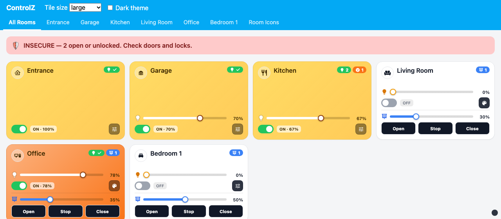

## Install

[](https://my.home-assistant.io/redirect/hacs_repository/?owner=brientim&repository=controlz-ha&category=plugin)

The button opens ControlZ HA in your Home Assistant and offers to add it as a custom repository. It works with both stores:

- **Home Assistant 2026.11 and newer — Marketplace.** HACS is built into Home Assistant as **Settings → Marketplace**. Select **Download**, then reload your browser. Updates appear under **Settings → Updates**.
- **Home Assistant 2026.10 and older — HACS.** In **HACS**, three-dot menu → **Custom repositories**, add `https://github.com/brientim/controlz-ha` with type **Dashboard**, then open **ControlZ HA**, select **Download**, and reload your browser.

Either store adds the dashboard resource for you (Lovelace storage mode, the default). Upgrading from HACS to 2026.11 moves an existing install to the Marketplace automatically. Because ControlZ HA is added from a link (not the default catalog), the store checks GitHub for new releases about every 48 hours, and needs a GitHub connection to do so.

### Create the ControlZ dashboard

1. **Settings → Dashboards → Add dashboard → New dashboard from scratch**, name it "ControlZ".
2. Open it, then three-dot menu → **Edit dashboard** → three-dot menu → **Raw configuration editor**.
3. Replace everything with:

```yaml
strategy:
  type: custom:controlz-rooms
```

You get an **All Rooms** view (security banner, All / On / Off filter and a tile per room), a **Favorites** view, an **Automations** view and one view per area. Tapping a room tile opens that room. Add `room_nav: sidebar` for the ControlZ room sidebar instead of tabs.

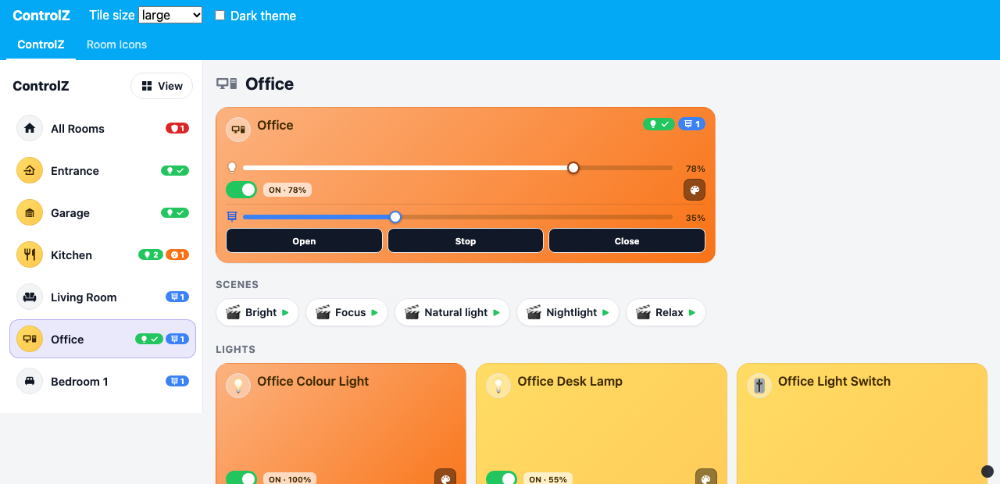

### Rooms: tabs or sidebar

- **Tabs** (`room_nav: tabs`, default): All Rooms plus one Home Assistant view per area; the view tabs are the room strip.
- **Sidebar** (`room_nav: sidebar`): a ControlZ-style room sidebar with each room's icon and badge chips (green lights, orange outlets, blue coverings; All Rooms shows the security state), with Favorites and Automations under All Rooms. The selected page fills the rest of the screen, and the URL (`#room=office`, `#page=favorites`) keeps back / forward and links working. Below 700 px wide the sidebar becomes a horizontal room strip, like ControlZ on iPhone.

### View menu

Every page has a **View** menu (top right; in the sidebar next to the title) to pick the **tile size** (Large / Thin / Compact), the **scale** (slider 50–120%, plus 50 / 60 / 80 / 100% buttons) and **Rooms** layout (Tabs / Sidebar). The choice is saved on that device only, so a wall tablet can use Compact + Sidebar while a phone keeps Large + Tabs; **Use dashboard defaults** clears it. Tile size and scale change immediately; switching Tabs / Sidebar reloads the page.

**Scale** shrinks everything below the page header together — tiles, controls, text and spacing — so tiles keep their look, controls keep fitting, and more tiles fit on screen (60% shows about 1.7× as many per row). The header, View menu and controls sheets stay full size. Set a dashboard default with `tile_scale` (any value from 0.4 to 1.5). At 50–60% text and buttons are small; 80% is a good middle ground on touch screens.

**This room** (ControlZ per-room tile size): on a room's page, the View menu also sets that room's own tile size, for rooms that work better at another size (a garage with one light as Compact, a busy kitchen as Thin). **Same** follows the tile size above. Admins also get **This room for everyone**, saved in the dashboard config (`room_tile_sizes`). A room uses this device's choice first, then the one for everyone, then the usual tile size. It applies to the room's page; room tiles on All Rooms keep the usual size so the grid stays even.

**Lock button**, **Accent** and **Corners** (ControlZ accessibility and colour scheme settings): what a lock tile's button does (see [Security banner](#security-banner)), the accent colour for buttons and selections (ControlZ indigo, your Home Assistant theme colour, blue, teal, green, amber, rose or slate), and rounded or square tiles. Like the rest of the menu, they are saved on this device only.

**Start page** (ControlZ Startup Room): open any room, Favorites, Automations or a house page and choose **View → Start on …** to make this device open there. It only applies when the dashboard is opened, so going back to All Rooms afterwards stays on All Rooms. **Start on All Rooms** clears it.

**Version and Help**: the bottom of the View menu shows the installed ControlZ HA version and **? Help**: what's new in this version, a short guide to each feature with a screenshot, and links to this guide, the release notes and the issue tracker. Screenshots and links follow the installed version; the screenshots load from GitHub, so they need an internet connection.

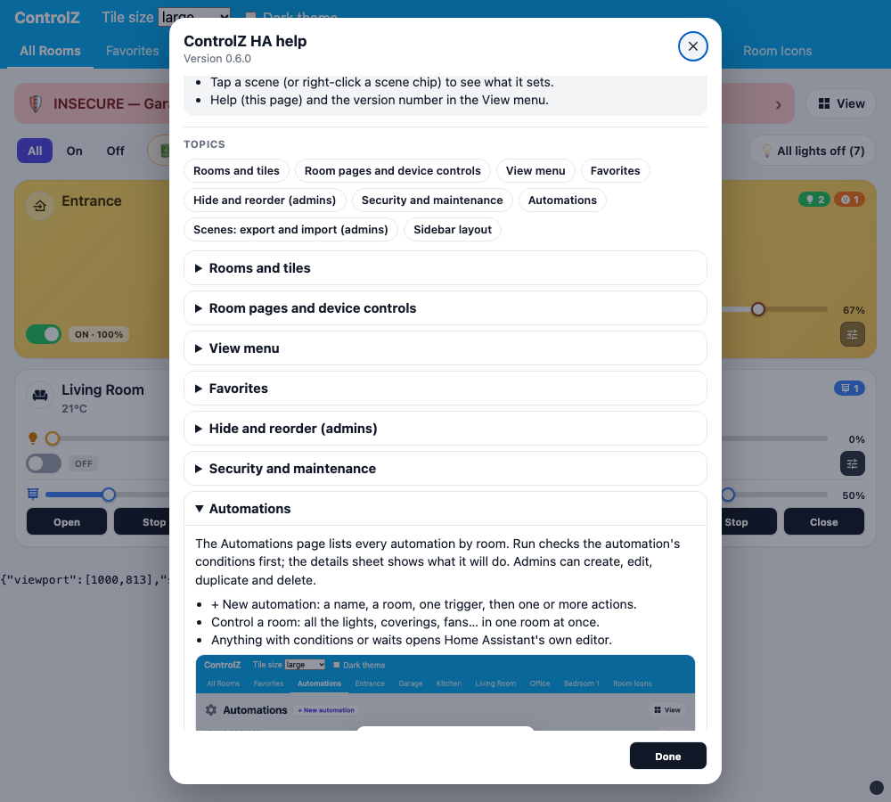

### Favorites

Your favorite rooms, scenes and devices, on the **Favorites** view (tabs) or the Favorites row (sidebar). Tap ♥ in a room's or device's controls (light, thermostat, fan, alarm, automation), or choose **View → Edit favorites…** and tap ♥ on any tile.

Favorites are saved **per Home Assistant user** (Home Assistant's frontend user data), so every member of the household keeps their own list and it follows them to every phone, tablet and browser. Non-admins can edit their favorites too. If that storage is not available, favorites are kept in the browser instead. Hidden rooms and devices stay out of Favorites. Turn the view off with `favorites_view: false`.

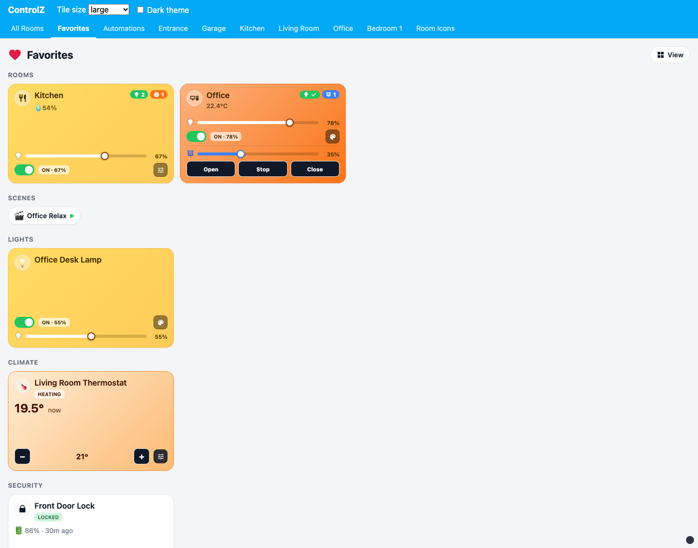

### Edit rooms & favorites: hide, show and reorder

**View → Edit rooms & favorites…** (on the ControlZ dashboard) puts a ♥ on every tile and sidebar room for everyone. Home Assistant admins also get a hide / show button and arrows to reorder (on a computer you can also drag a tile onto another one):

- **Rooms** on All Rooms and in the sidebar (▲▼). Room views (tabs) follow after **Done**.
- **Device tiles** on a room page, within each section (Lights, Scenes, Security, …). Scene chips follow the new order. The Automations view reorders automations within each room and shares that order with the room page.
- **Favorites**: on the Favorites page every user can reorder their own favorite rooms and devices; that order is saved with their favorites.

Hidden items stay dimmed while you edit so you can bring them back; press **Done** when finished. Hiding and room / device order are saved in the dashboard config (`hide_areas`, `hide_entities`, `areas_order`, `entities_order`), so they apply on every device; devices you never moved keep their alphabetical place after the ones you did. Hidden devices also drop out of their room tile (on/off, brightness, badge counts). They still count for the security banner — use `security_exclude` for that.

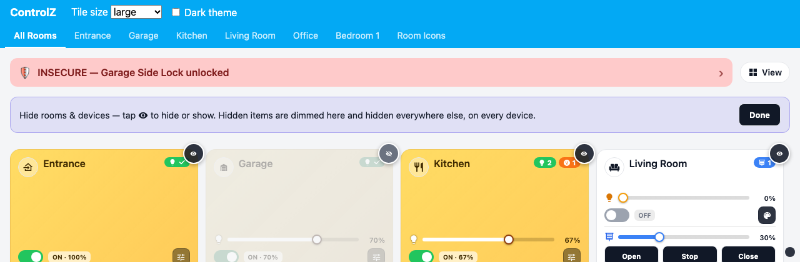

### All Rooms: what's on, all lights off, maintenance

- **All / On / Off** (ControlZ light filter) shows every room, the rooms with lights or outlets on, or the rooms where everything is off. **On** also lists every light, switch, outlet and fan that is on right now, across the house. The choice is kept on this device.
- **All lights off** turns off every light and wall switch in the rooms on the page (after asking). Outlets such as a kettle are left alone.
- **Maintenance** (ControlZ Low Battery Report): a chip appears when a battery is under `battery_threshold` % (default 20) or a device is unavailable. Tap it for the list, then a device for its details. Battery sensors count even though Home Assistant files them as diagnostic entities. Hide the chip with `show_maintenance: false`.
- **Scenes & presets**: scenes and scripts that are in no room (house-wide, like ControlZ's Home / Away / Bedtime presets) show as chips. Admins get **+ New preset**.
- **📢 Announce** appears when Home Assistant has a text-to-speech voice and a media player (see [Media and announcements](#media-and-announcements)). Turn it off with `show_announce: false` on the card.
- **Running**: while a script runs, a green banner names it with **Cancel** (room pages show their own scripts).

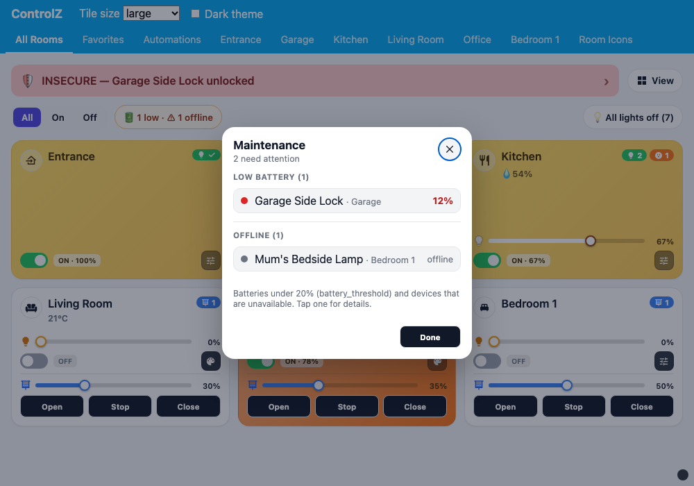

### Room pages: status, filters and the room tile

- **Status chips** under the room name (ControlZ room sensor banner): motion now (or when it was last seen), open doors and windows, unlocked locks and alarms, and what the thermostat is doing ("Heating to 21° · now 19.5°"). Tap one for that device. **📈 History** opens the room's sensors (below). Hide the row with `show_room_status: false` on the room card.
- **Filters** (ControlZ light filter and device types): **All / On / Off / ♥** and one device type (Lights, Window Coverings, Climate, Media, Security, …). "On" means lit, open, playing, heating, unlocked or moving. The choice is kept on this device and applies to every room. Hide the row with `show_filter: false`.
- **What the room tile controls** (ControlZ Room Master exclusions): in **View → Edit rooms & favorites…**, admins get a bulb button under each light on a room page. Turn it grey and the room tile's switch, brightness, colours and green badge leave that light alone (handy for a night light or a lamp on its own schedule); it keeps its own tile. Saved for everyone as `room_exclude`.

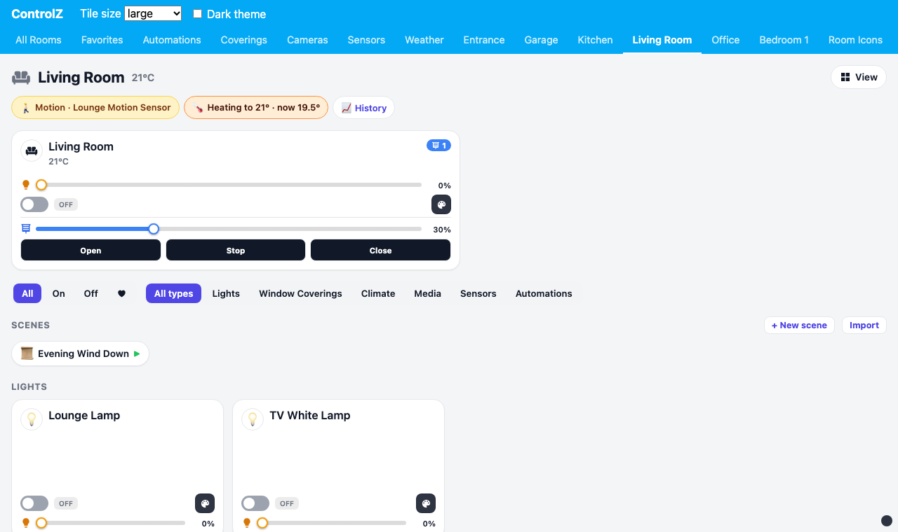

### History: sensors, rooms and security

History comes from Home Assistant's recorder (ControlZ Sensor History and Security Trigger History), so it covers everything Home Assistant has kept (10 days by default).

- **A sensor**: tap a temperature, humidity, light, motion, door or window tile for its chart over 6 hours, 24 hours or 7 days, with the low, high and average (motion and doors: how many times, and for how long in all).
- **A room**: **📈 History** on a room page shows every sensor in the room with a small chart and its low / high.
- **Security history**: tap the security banner, then **What happened (history)**: every door, window, lock, alarm and motion change, newest first and grouped by day. Filter by time, type (Doors, Windows, Locks, Motion, Alarms), room and a search, then **Export CSV**. It follows the banner's `security_include` / `security_exclude` and hidden devices.

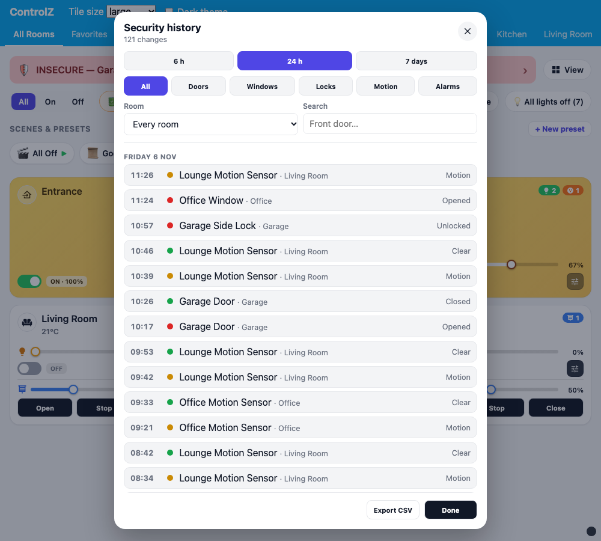

### Scenes and presets

- **Collapse**: tap the chevron (or the heading) on a room's **Scenes** row, All Rooms' **Scenes & presets** or Favorites' Scenes to fold it down to its heading and count. Each row is remembered on this device.
- **Hide** (admins): in **View → Edit rooms & favorites…**, **Hide for everyone** on a Scenes row hides that room's scene row (or All Rooms' Scenes & presets) for everyone on the dashboard; it stays dimmed in edit mode so you can **Show for everyone** again. Saved as `hide_scenes`. To hide single scenes, use the eye on the scene in edit mode.
- **+ New scene** (admins, on a room's Scenes heading): set the room how you want it, tick the lights, switches, coverings, fans and thermostats to include, name it, and it is saved as an ordinary Home Assistant scene in that room, set to how those devices are right now (ControlZ scene capture).
- **Update to how it is now** in a scene's sheet saves the current state of the scene's devices into it (after asking).
- **Ask before running** (admins, in a scene's or preset's sheet) makes everyone confirm before it runs (ControlZ "confirm before run"; saved as `confirm_scenes`). Its chip shows ?▶.
- **Presets** (ControlZ preset sequences): **+ New preset** on All Rooms or the Automations view. A preset is a name, an icon, a room (or house-wide) and steps run in order: scenes, waits, scripts, devices, whole rooms, notifications and announcements. It is saved as an ordinary Home Assistant script, so voice assistants and automations can run it too. Tap a preset (or right-click its chip) for its steps, **Run** / **Cancel**, and for admins **Edit**, **Open in Home Assistant** and **Delete**. Scripts with choices, repeats or fields open Home Assistant's script editor instead.

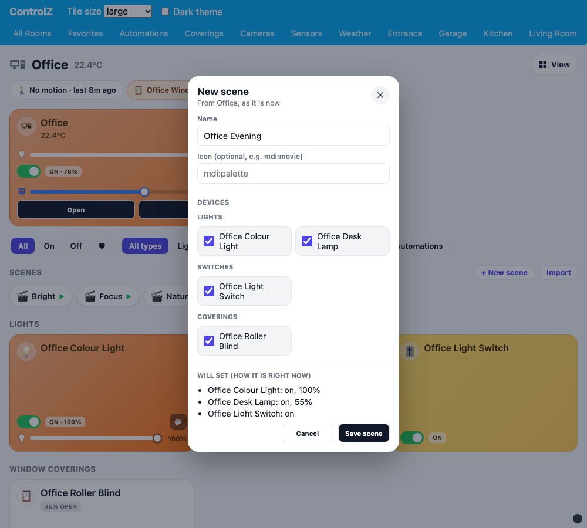

### House pages: coverings, cameras, sensors and weather

Like ControlZ's system rooms, the dashboard adds a page for each of these when Home Assistant has something to show (turn one off with `coverings_view`, `cameras_view`, `sensors_view` or `weather_view: false`):

- **Window Coverings**: every covering by room, how many are open, and **Open all**, **Stop all** and **Close all** (open and close ask first).
- **Cameras**: every camera by room.
- **Sensors**: **By room**, **By type** (Motion, Temperature, Humidity, Light level, Air quality, Power, Pressure; ControlZ Sensor Report) or **Batteries & offline** (every battery level, lowest first, and offline devices).
- **Weather**: current conditions (feels like, humidity, wind, pressure, UV), the next 24 hours, the next 7 days with a temperature range bar, and the sun (up or down, sunrise, sunset, dawn and dusk) from `sun.sun`. It uses the first weather entity, or `weather_entity`. Forecasts stay live while the page is open.

With the sidebar they sit under Favorites and Automations.

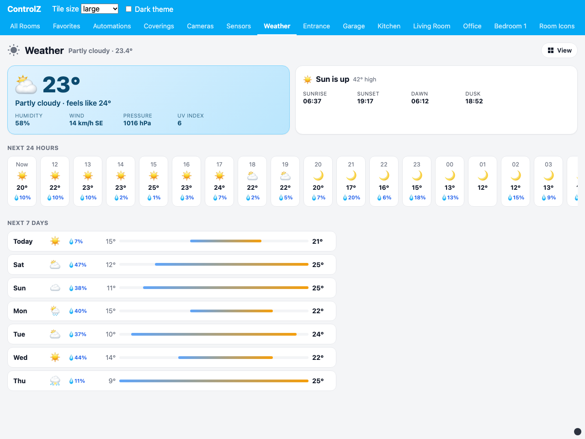

### Media and announcements

**Media players** get their own tile (ControlZ Sonos player): what is playing, previous / play-pause / next, and on Large a volume slider with a speaker icon and a violet fill. The tile turns violet while playing. Tap it (or its controls button) for volume, mute, source, power and **Announce**.

**Announce** (ControlZ AirPlay / Sonos text to speech): tick the speakers, type what to say or tap a saved phrase, and Home Assistant speaks it with `tts.speak`. **Save this phrase** keeps it on this device. It needs a text-to-speech voice in Home Assistant (Settings → Voice assistants).

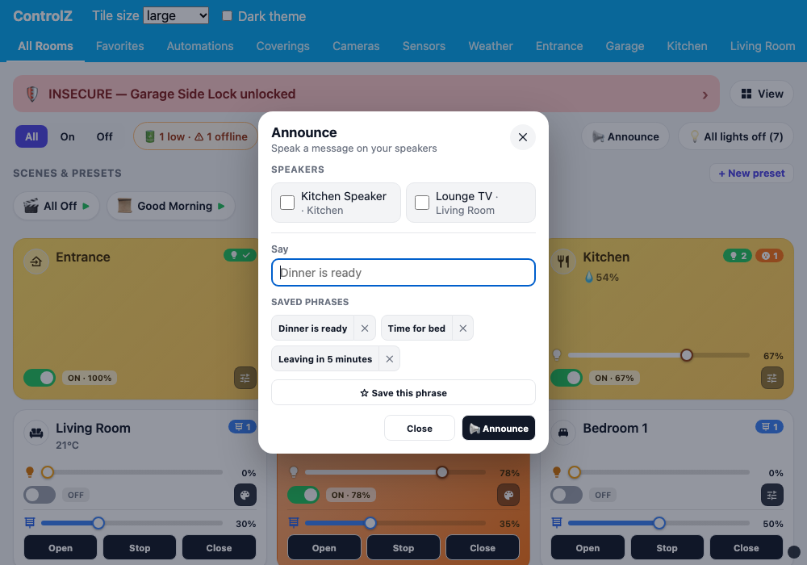

### Automations

Automations have their own **Automations** view (grouped by room, then "No room") and an Automations section on each room page. Each automation tile has:

- **Run** — asks first, then runs the automation **with its conditions checked**. (Earlier versions ran automations from the scene row with `automation.trigger`, which skips conditions by default.) The details sheet also has **Run, skip conditions**.
- **Enable / disable** (⏻).
- **What this will do** — the automation's triggers, conditions and actions in plain words ("When Front Door changes to on", "Turn on Hall Light").
- For Home Assistant admins: **Edit**, **Delete**, and in the details sheet **Duplicate**, **Traces** and **Open in Home Assistant**.

**+ New automation** (Automations view, or **+ New** on a room's Automations heading) opens a simple editor like ControlZ's Events: a name, a room, one trigger and one or more actions, run in order.

- **When**: at a time; a device changing; sunrise / sunset with an offset; **every** so many minutes or hours; a person **arriving at or leaving** a place (a Home Assistant zone, from the companion app); or the **sun height** going below or above some degrees (-6° is dusk).
- **Then**: activate a scene, run a script, control a device, control a room (e.g. turn off all the lights in the Kitchen), **send a notification** (to a phone or `notify.notify`), **announce** a message on a speaker, or **wait** some minutes and seconds.

Device pickers are grouped by room in your dashboard's room order. It saves through Home Assistant's own automation config API, so the result is an ordinary Home Assistant automation. **Edit** uses the same editor when an automation is that simple; anything with conditions, choices, waiting for something to happen, extra data or templates opens Home Assistant's automation editor instead, so nothing is ever rewritten in a simpler form. Turn the view off with `automations_view: false`; room pages still list their automations.

### Export and import

Admins only. **Export** in an automation's or a scene's details sheet shows its config as YAML or JSON, with Copy, Download and (on phones and the companion app) Share. It is the config exactly as Home Assistant stores it, so it also pastes into Home Assistant's "Edit in YAML". **Import** (Automations view, or a room's Scenes heading) takes pasted YAML / JSON or a `.yaml` / `.json` file with one scene or automation or a list of them, shows what it found (and any scene devices this Home Assistant does not have), and adds each one **as new** in the chosen room — nothing existing is replaced.

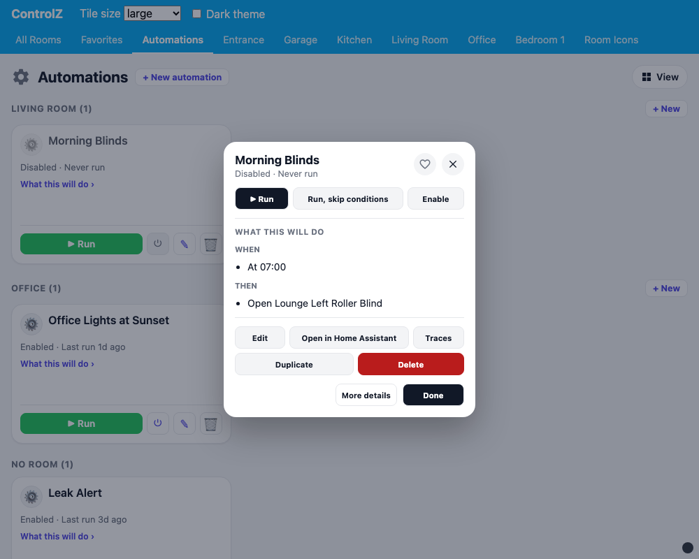 With tabs, the page reloads after Done so hidden rooms leave the tab bar.

### Security banner

The banner at the top of All Rooms looks at every Home Assistant device that gets a Security tile, in every area, and names the ones that need attention. Tap it for the full list; tap a device for its details.

**Where it shows**: admins choose **View → Security banner…**: **All Rooms only** (default), **Every room and page** (also at the top of every room page and of Favorites, Automations, Window Coverings, Cameras, Sensors and Weather), **Chosen rooms and pages** (All Rooms plus the rooms and pages you tick) or **Off**. It is saved in the dashboard config (`security_banner`, `security_banner_rooms`; pages are saved as `page:favorites`, `page:weather`, …), so it applies on every device. A banner on any page still shows the whole house, so you see an open garage door from the bedroom. With the sidebar, the All Rooms badge keeps showing the security state even when the banner is off.

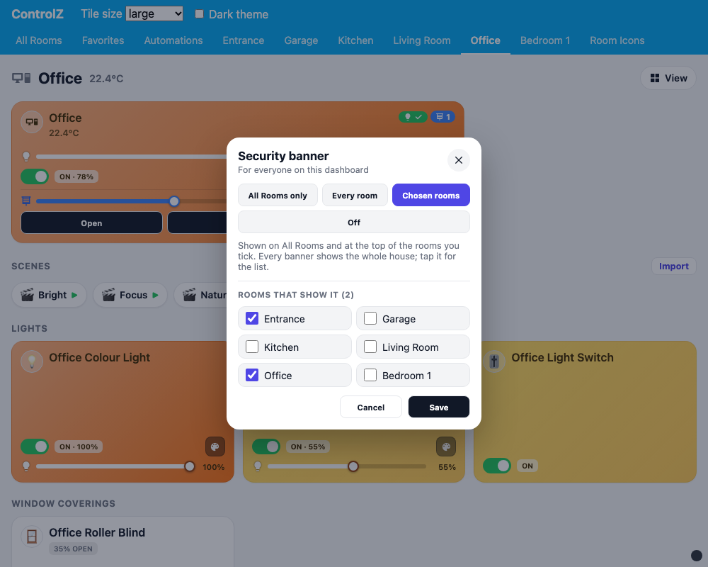

| Banner | When |
|--------|------|
| **INSECURE** (red) | A lock is unlocked or open, a door / opening / garage door sensor or garage / gate cover is open, an alarm panel is triggered, or a smoke / gas / CO / leak / safety / tamper sensor is on |
| **CHECK** (amber) | A window sensor is open or a lock is jammed (and nothing is red) |
| **MOTION** (yellow) | A motion / occupancy / presence sensor is on (and nothing is red or amber) |
| **SECURE** (green) | None of the above |

Unavailable devices, hidden entities and diagnostic entities never raise the banner. Like ControlZ's Security membership, you can scope it: `security_include` (only these entities count) or `security_exclude` (these never count).

**Alarm panels**: tap the alarm tile (or its ARM / DISARM button) for the ControlZ keypad. It offers the arm modes the panel supports (Away, Home, Night, Vacation, Bypass) and a number keypad or code field when the panel needs a code. Panels that arm without a code arm Away in one tap from the tile.

**Locks**: tap a lock tile for the lock sheet (Lock, Unlock, Open when the lock can unlatch, a code field when it needs one, battery and **History**). What the tile's LOCK / UNLOCK button does is set per device in **View → Lock button** (ControlZ lock tap mode): **Ask first** (ask before unlocking; the default), **Instant**, or **Controls** (open the lock sheet).

### Manual install

Download `controlz-ha.js` from the [latest release](https://github.com/brientim/controlz-ha/releases/latest), copy it to `config/www/`, and add `/local/controlz-ha.js` as a **JavaScript module** under **Settings → Dashboards → Resources**. Don't combine this with a Marketplace / HACS install, or two copies of the cards load.

## What you get

| Card | Purpose |
|------|---------|
| `custom:controlz-rooms` (strategy) | Generates the whole dashboard: All Rooms plus one view per area. The view tabs act as the room strip. |
| `custom:controlz-room-card` | Room tile for one area. Green chip = lights on (lights only, not switches/outlets), orange = outlets on, blue = coverings open. Rooms with lights and coverings control both. |
| `custom:controlz-room-grid` | A full room page: status chips, room tile, filters, then Scenes, Lights, Window Coverings, Climate, Media, Security, Cameras, Sensors, Automations and Other. |
| `custom:controlz-home-grid` | All Rooms: security banner (tap for the device list and history), All / On / Off filter, All lights off, Announce, maintenance chip, house-wide scenes & presets, and a room tile per area. |
| `custom:controlz-house-grid` | A house page (`page: coverings`, `cameras` or `sensors`): every covering, camera or sensor by room. |
| `custom:controlz-weather-grid` | Weather: now, the next 24 hours, the next 7 days and the sun (`weather_entity` optional). |
| `custom:controlz-favorites-grid` | Favorites: your favorite rooms, scenes and devices (per Home Assistant user). |
| `custom:controlz-automations-grid` | Automations by room: run, enable, details; admins also new / edit / duplicate / delete. |
| `custom:controlz-rooms-app` | Sidebar layout: room sidebar plus the selected room (use in a panel view; the strategy adds it for `room_nav: sidebar`). |
| `custom:controlz-tile-card` | One device tile; the tile type is picked from the entity. |
| `custom:controlz-room-icons-card` | The icon each room resolved to (and why), plus the searchable room icon registry. |

**Tile sizes.** Every card takes `tile_size: large | thin | compact`. All tiles of a size have the same height (Large 200 px, Thin 100 px, Compact 150 px) and never grow. Each size shows what fits; the room controls popup (the button on every room tile) always has on/off, brightness, Warm / Neutral / Cool, colours and coverings.

| Size | Room tile |
|------|-----------|
| Large | Brightness slider + on/off; coverings position + Open / Stop / Close |
| Thin | One row: on/off + controls button (coverings-only rooms: Open / Stop / Close) |
| Compact | Badge chips under the name; on/off, plus Open / Stop / Close for rooms with coverings |

**Sliders.** Brightness sliders have a lightbulb and an amber fill (white on lit tiles); covering position sliders have a blinds icon and a blue fill; fan speed sliders have a fan icon and a teal fill; volume sliders have a speaker icon and a violet fill.

**Room readings.** Large room tiles and the room page title show the room's temperature and humidity (💧): the average of its temperature / humidity sensors, else its motion sensors' own thermometers, else its thermostat.

**Thermostats** (ControlZ thermostat tiles) show the mode or what the thermostat is doing (HEATING, COOL, AUTO, OFF), the current temperature, and a − setpoint + row; the tile turns orange while heating and blue while cooling. Quick presses are sent as one setpoint. The thermostat sheet has the target (or Heat to / Cool to for a range), modes, presets and fan modes.

**Fans** have a power toggle and chip (teal when on), a speed slider on Large, and a sheet with speed, presets, oscillation and direction. **Cameras** show the latest snapshot (refreshed every 10 s while the page is visible); tap for Home Assistant's live view.

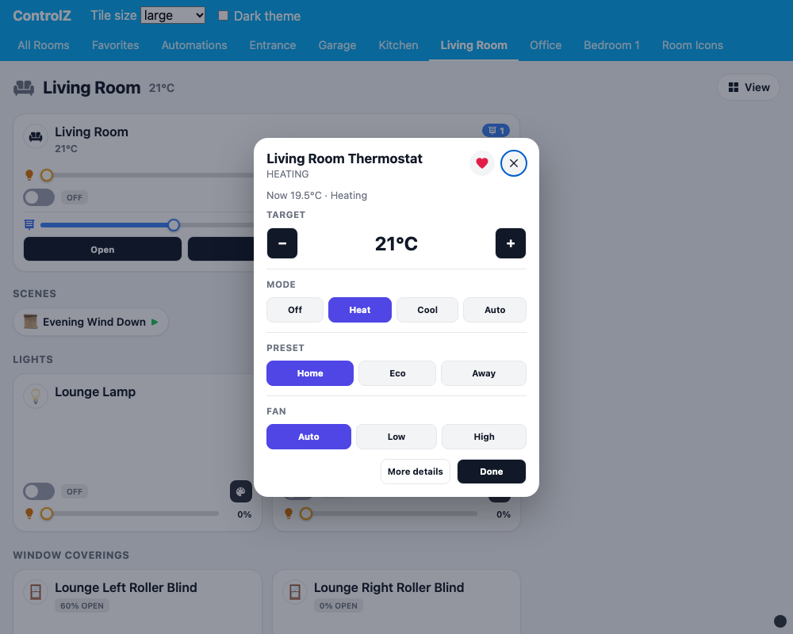

**Scenes** show as a row of chips on each room page; tap to run, right-click for the scene sheet (what it sets; Export for admins). Tapping a scene tile opens the same sheet. The room name Hue adds is dropped, so "Kitchen Bright Kitchen" reads "Bright". Set `scenes_style: tiles` for full scene tiles.

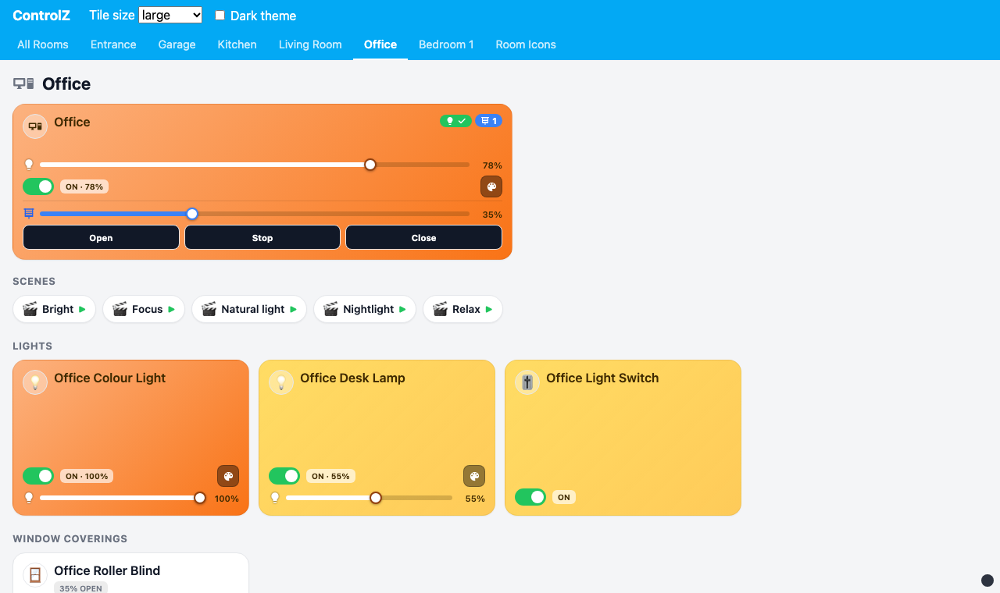

### How Home Assistant maps to ControlZ

| ControlZ | Home Assistant |
|----------|----------------|
| Room | Area (an entity's own area wins over its device's area) |
| Light tile | `light.*`; `switch.*` (wall switch); `switch.*` with `device_class: outlet` (outlet) |
| Window covering tile | `cover.*` (except garage / gate) |
| Security tile | `lock.*`, `alarm_control_panel.*`, garage/gate covers, door / window / opening / smoke / gas / CO / moisture binary sensors |
| Sensor tile | Motion / occupancy / presence binary sensors (with temperature from the same device); temperature, humidity, lux, CO₂, PM, power sensors |
| Thermostat tile | `climate.*` |
| Fan tile | `fan.*` |
| Security camera | `camera.*` |
| Media tile | `media_player.*` |
| Scene / preset | `scene.*`, `script.*` |
| Automation tile | `automation.*` |
| Other | humidifier, vacuum, valve, water heater |

Hidden entities and config/diagnostic entities are skipped. Tapping a light opens the compact ControlZ light sheet (on/off, brightness, Warm / Neutral / Cool, colours); sensors, doors and windows open their history; locks the lock sheet; media players the player sheet. **More details** in a sheet opens Home Assistant's own dialog; the remaining tiles open it directly. ControlZ sheets fit any window: their content scrolls when the window is short, and they become a bottom sheet on phones.

### Room icons

Room icons come from the ControlZ room icon registry (114 room types with room-name suggestions), mapped to Material Design Icons. The icon for each room is chosen in this order:

1. `icon:` on a room card
2. `room_icons:` on the strategy (per area id)
3. ControlZ suggestion from the room name: exact match, then whole-word partial match ("Bedroom 1" → Bedroom, "Upstairs Toilet" → Toilet)
4. The Home Assistant area icon
5. House (or Blinds for coverings-only rooms)

Set `icon_source: area` to prefer Home Assistant area icons. An icon can be a registry name (`Library`), a registry id (`system:sofa.fill`) or any `mdi:` icon.

## Options

```yaml
strategy:
  type: custom:controlz-rooms
  room_nav: tabs                   # tabs | sidebar
  tile_size: large                 # large | thin | compact (each device can override in the View menu)
  room_tile_sizes:                 # a room's own tile size for everyone (View → This room for everyone sets it)
    garage: compact
  tile_scale: 1                    # 0.4–1.5, e.g. 0.6 = 40% smaller (View menu: 100 / 80 / 60%)
  areas_order: [office, kitchen]   # pinned first
  hide_areas: [utility]            # rooms left out (View → Edit rooms & favorites edits this and areas_order)
  hide_entities: [switch.kettle]   # devices left out of tiles and room controls
  entities_order:                  # device tile order per room (edit mode writes this); others follow by name
    office: [light.office_desk_lamp, light.office_colour_light]
  scenes_style: chips              # chips | tiles
  security_banner: all_rooms       # all_rooms | every_room (rooms and pages) | rooms | off (View → Security banner… sets this)
  security_banner_rooms: [office, page:favorites]   # with security_banner: rooms — rooms (area ids) and pages that also show it
  hide_scenes: [office, __home]    # scene rows hidden for everyone (area ids; __home = All Rooms' Scenes & presets)
  security_include: []             # only these entity ids raise the security banner
  security_exclude: [binary_sensor.office_window]   # never raise the banner
  room_exclude: [light.night_lamp] # lights the room tile leaves alone (edit mode's bulb button writes this)
  confirm_scenes: [script.away]    # scenes / presets that ask before running (their sheet sets this)
  favorites_view: true             # false = no Favorites view
  automations_view: true           # false = no Automations view (room pages still list automations)
  coverings_view: true             # false = no Window Coverings page
  cameras_view: true               # false = no Cameras page
  sensors_view: true               # false = no Sensors page
  weather_view: true               # false = no Weather page
  weather_entity: weather.home     # which weather entity the Weather page shows (default: the first)
  battery_threshold: 20            # All Rooms maintenance chip: batteries under this % are low
  show_maintenance: true           # false = no low battery / offline chip
  icon_source: controlz            # controlz | area
  room_icons:                      # per-area icon overrides
    office: Library
  view_icons: false                # true = room icons in the tabs (HA then hides tab titles)
  icons_view: false                # true = extra Room Icons view
```

Single cards in any dashboard:

```yaml
type: custom:controlz-room-card
area: living_room
navigation_path: /dashboard-controlz/room-living_room   # optional: tap opens that view
---
type: custom:controlz-tile-card
entity: light.office_colour_light
tile_size: thin
```

## Limitations

- New areas or devices moved between areas appear after a dashboard reload. With tabs, a reordered room list also follows after a reload (the page reloads itself after **Done**).
- Editing, duplicating and deleting automations needs a Home Assistant admin (Home Assistant's automation config API is admin-only). YAML automations without an `id` can be run and enabled, but not read or edited here. The same goes for exporting and importing scenes and automations, and for YAML scenes without an `id`. Import does not handle scripts or Home Assistant YAML tags such as `!secret`.
- Favorites changed on one device show on another after it reloads.
- History needs Home Assistant's recorder (on by default) and only goes back as far as it keeps (`purge_keep_days`, 10 days by default). Entities the recorder excludes have no chart.
- Presets are Home Assistant scripts, read and saved by their object id (`script.bedtime` → `bedtime`). A script whose entity id was renamed away from its key, or one in YAML files, opens Home Assistant's editor.
- Saved phrases, the lock button, accent and corners are kept per device (like the rest of the View menu), not per user.
- Tested on Home Assistant 2026.10.

## Development

```bash
npm install
npm test            # unit tests (node:test)
npm run build       # dist/controlz-ha.js
npm run serve       # then open http://127.0.0.1:8765/dev/harness.html (add ?fresh=1 to clear saved hides)
```

`dev/harness.html` renders the dashboard against a mock `hass` (`dev/fixture.js`); service calls change the fixture state and show in a log overlay. The mock also fakes the automation, scene and script config APIs, recorder history, weather forecasts, frontend user data (favorites) and entity registry updates for the browser session (`?fresh=1` resets them). Query parameters: `?view=room-office&size=thin&dark=1&nav=sidebar&admin=0&open=menu|security|edit|maintenance|light-sheet|room-sheet|climate-sheet|fan-sheet|alarm-sheet|lock-sheet|media-sheet|automation-sheet|editor-sheet|scene-sheet|export-sheet|import-sheet|help-sheet|security-settings|sensor-history-sheet|room-history-sheet|security-history-sheet|scene-capture-sheet|announce-sheet|script-sheet|preset-sheet` (`&fill=1` or `&fill=2` fills in the editor and `&save=1` saves it; `&section=automations` opens a help topic; `&mode=rooms&rooms=office` for the banner settings). `&banner=every_room` sets `security_banner` for the session, `&roomsizes=garage:compact` sets `room_tile_sizes`, `&click=<selector>` clicks after opening, `&prefs={"accent":"teal"}` sets this device's View menu prefs, `&run=script.good_morning` starts a script, and `&probe=script.` prints matching entities and saved configs. `?fit=1` measures every tile at every size and reports any that are off-contract, clipped, overflowing or off-screen (plus `window.__errors`); add `&scale=0.6` and `&nav=sidebar` to check those too.

**Deploy a dev build without HACS** (copies to `config/www` over SSH and creates the dashboard):

```bash
export HA_TOKEN='...' HA_URL='http://homeassistant.local:8123'
export HA_WWW_SCP_TARGET='root@homeassistant.local:/config/www/'
python3 scripts/deploy.py            # --tile-size compact | --cards-only | --status
python3 scripts/deploy.py --remove-local   # after switching to the Marketplace / HACS install
```

**Release:** bump the version (`npm version patch --no-git-tag-version`), commit, then `./scripts/release.sh` — it tests, builds, tags, pushes, and creates the GitHub release with `controlz-ha.js` attached. The Marketplace and HACS install that release asset (they look for `controlz-ha.js`, named in `hacs.json`).

## License

[MIT](LICENSE)
